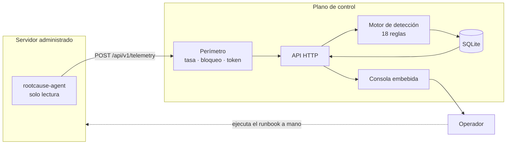

# 01 · Descripción general del sistema

> Documento de entrada. Explica qué es RootCause Server, qué problema resuelve
> y cómo funciona a grandes rasgos, antes de cualquier detalle técnico.
> Fuente: análisis del commit `2efedb2`, versión `0.2.0`.

## Qué es el sistema

RootCause Server es un **plano de control de defensa para servidores**. Se
compone de dos programas y una consola web:

1. **`rootcause-agent`** — un sensor nativo de solo lectura que se instala en
   cada servidor administrado. Mide recursos y observa la superficie de
   seguridad del equipo, y envía el resultado por HTTP.
2. **`rootcause-server`** — el plano de control. Recibe esa telemetría, la
   guarda, ejecuta sobre ella 18 reglas de detección deterministas y expone un
   API y una consola.
3. **La consola** — una interfaz web sin dependencias externas que viaja
   **compilada dentro del binario del servidor** (`crates/rootcause-server/src/ui.rs`
   incrusta el directorio `console/` con `rust-embed`).

Ambos programas están escritos en Rust y comparten un tercer componente,
`rootcause-core`, que contiene el modelo de dominio y todo el motor de
detección **sin ninguna operación de entrada/salida**.

El propio repositorio resume la intención en una frase que aparece en el
`README.md`: *«Diagnóstico primero. Intervención después.»*

## Qué problema resuelve

El problema declarado es la **dispersión de la evidencia**. Un servidor ya
escribe registros: los escribe la aplicación, la base de datos y el sistema
operativo. Cada uno ve su parte y ninguno ve la frase completa.

El ejemplo que el proyecto usa para explicarse:

- un puerto de base de datos publicado en `0.0.0.0`,
- una ráfaga de intentos de acceso fallidos desde una sola dirección,
- veinte minutos después, una sesión concedida a esa misma dirección.

Ninguno de esos tres hechos es un incidente por separado. Los tres juntos, sí.
RootCause Server no reimplementa lo que ya existe: **correlaciona lo que nadie
está mirando junto**, y lo expresa en una frase accionable.

Esa correlación existe como regla concreta en el código:
`intrusion.auth.success_after_burst`, en
[`crates/rootcause-core/src/detect/intrusion.rs`](../../crates/rootcause-core/src/detect/intrusion.rs),
que se dispara con severidad crítica cuando un origen que acumulaba fallos
consigue autenticarse.

## A quién está dirigido

| Actor | Qué hace con el sistema |
|---|---|
| **Administrador de sistemas / SRE** | Instala el agente, revisa la consola, decide si ejecuta un runbook |
| **Responsable de seguridad** | Consulta superficie expuesta, orígenes que presionan la autenticación y postura |
| **Auditor** | Descarga el paquete de evidencia NDJSON y revisa el registro de auditoría |
| **Equipo de plataforma** | Consume `/metrics` desde Prometheus y `/healthz` desde el orquestador |

No hay usuarios con contraseña ni roles dentro del producto: **la autenticación
es un único token compartido** (ver [11 · Seguridad](11-security.md)). Cualquiera
que tenga el token ve todo.

## Casos de uso principales

1. **Inventariar la superficie expuesta de una flota.** Qué servicio de qué
   equipo es alcanzable desde fuera, y con qué alcance (solo local, red interna
   o público).
2. **Detectar presión sobre la autenticación.** Ráfagas desde un origen,
   barridos de nombres de usuario, campañas distribuidas, y el caso crítico de
   un acceso concedido después de la ráfaga.
3. **Vigilar la integridad de los archivos que deciden quién entra.**
   `sshd_config`, `sudoers`, `authorized_keys` y compañía, por huella SHA-256.
4. **Comprobar controles básicos.** Firewall del host activo y con denegación
   entrante, parches de seguridad pendientes, reloj sincronizado.
5. **Notar que un sensor se calló.** Un agente que deja de reportar es un
   hallazgo, no un silencio.
6. **Anticipar saturación.** CPU sostenida varias muestras seguidas, presión de
   memoria, disco al límite y proyección de horas hasta llenarse.
7. **Entregar evidencia.** Exportación NDJSON con activos, incidentes y
   auditoría.

## Funcionalidades principales

| Funcionalidad | Dónde vive | Superficie visible |
|---|---|---|
| Catálogo de 18 reglas publicado por el propio binario | `detect/mod.rs`, constante `RULES` | `rootcause-server rules`, `GET /api/v1/rules` |
| Política de detección versionable y validada al arrancar | `policy.rs` | `rootcause-server policy`, `GET /api/v1/policy` |
| Motor de detección determinista | `detect/*.rs` | `POST /api/v1/telemetry` |
| Puntuación de postura con lista de superficies no inspeccionadas | `posture.rs` | `GET /api/v1/status`, consola |
| Superficie expuesta de la flota | `api.rs::build_exposure` | `GET /api/v1/exposure` |
| Orígenes que presionan la autenticación | `storage.rs::threat_sources` | `GET /api/v1/threats` |
| Runbook guiado, nunca ejecutado | `runbook.rs` | `GET /api/v1/incidents/{id}/runbook` |
| Topología por zonas (Internet, expuesto, interno) | `api.rs::build_topology` | `GET /api/v1/topology` |
| Registro de auditoría | `storage.rs::audit` | `GET /api/v1/audit` |
| Exportación de evidencia | `api.rs::render_export` | `GET /api/v1/export` |
| Métricas Prometheus | `api.rs::render_metrics` | `GET /metrics` |
| Perímetro propio: límite de tasa y bloqueo | `defense.rs`, `auth.rs` | Respuestas `429`, contadores en `/api/v1/threats` |

## Flujo general de funcionamiento



**Lectura del diagrama.** El agente empuja telemetría; el servidor nunca la
pide. Antes de comparar el token, la petición atraviesa el perímetro propio del
plano de control. Aceptada la telemetría, el motor produce hallazgos, el
almacenamiento los deduplica por huella y la consola los muestra. La flecha de
vuelta al servidor administrado es **de puntos** a propósito: el sistema
escribe el runbook, y ejecutarlo es siempre una decisión humana fuera de
RootCause.

Un ciclo completo, paso a paso:

1. El agente refresca métricas y, salvo `--metrics-only`, inspecciona la
   superficie de seguridad: sockets en escucha, conexiones establecidas,
   eventos de autenticación agregados, huellas de archivos vigilados, estado del
   firewall y parches pendientes.
2. Registra el activo (`POST /api/v1/assets/register`) y envía el sobre
   (`POST /api/v1/telemetry`) con un token *bearer*.
3. El servidor valida versión de protocolo, rangos de la muestra y ventana
   temporal; guarda muestra y superficie.
4. Recupera hasta 12 muestras de historial y la línea base de huellas de
   archivos de ese activo.
5. Ejecuta el motor. Cada hallazgo lleva evidencia, causa raíz, confianza,
   acciones recomendadas, runbook y técnicas MITRE ATT&CK.
6. Deduplica por huella, cierra automáticamente lo que dejó de observarse
   **solo en las superficies que sí se pudieron inspeccionar**, recalcula la
   postura y registra auditoría.
7. Responde al agente con el número de incidentes tocados y las advertencias
   —incluidas las superficies que el agente declaró no haber podido mirar—.

## Entradas y salidas

**Entradas.**

| Entrada | Origen | Formato |
|---|---|---|
| Registro del activo | Agente | JSON `AssetRegistration` |
| Sobre de telemetría | Agente | JSON `TelemetryEnvelope` |
| Cambio de estado de incidente | Consola u operador | JSON `{status, actor}` |
| Política de detección | Archivo local (`--policy-file`) | JSON `DetectionPolicy` |
| Configuración | Argumentos de línea de comandos o variables de entorno | Texto |

**Salidas.**

| Salida | Consumidor | Formato |
|---|---|---|
| Estado, postura y endurecimiento | Consola, operador | JSON |
| Inventario, superficie, amenazas, topología | Consola | JSON |
| Incidentes y runbooks | Consola, operador | JSON |
| Auditoría | Auditor | JSON |
| Paquete de evidencia | Archivo externo | NDJSON |
| Métricas | Prometheus | Texto de exposición 0.0.4 |
| Registros del proceso | `stdout` | Texto compacto o JSON |

## Componentes más importantes

```text
crates/
  rootcause-core     dominio y detección  ·  sin red, sin archivos, sin reloj propio
  rootcause-agent    sensor de solo lectura, uno por servidor administrado
  rootcause-server   plano de control, API, almacenamiento y consola embebida
console/             la consola web, compilada dentro del binario del servidor
landing/             página pública del producto, publicada en GitHub Pages
packaging/           unidades systemd, plists de launchd e instalador de Windows
scripts/             guardianes de CI, prueba de humo, SBOM y utilidades
```

La regla que ordena todo el diseño: **`rootcause-core` no toca el mundo**. No
abre sockets, no lee archivos y no consulta el reloj salvo cuando el llamador se
lo entrega. Con la misma entrada y la misma política produce exactamente la
misma salida, y por eso un incidente se puede reevaluar meses después contra la
evidencia guardada.

## Tecnologías utilizadas

| Capa | Tecnología | Versión declarada |
|---|---|---|
| Lenguaje | Rust, edición 2024 | `1.95.0` fijado por `rust-toolchain.toml` |
| Servidor HTTP | `axum` | 0.8.9 |
| Capa de middleware | `tower-http` | 0.7.0 |
| Ejecución asíncrona | `tokio` | 1.47.1 |
| Persistencia | `sqlx` con SQLite | 0.8.6 |
| Cliente HTTP del agente | `reqwest` con `rustls-tls` | 0.12.23 |
| Métricas del sistema | `sysinfo` | 0.39.6 |
| Línea de comandos | `clap` | 4.5.46 |
| Serialización | `serde`, `serde_json` | 1.0.219 / 1.0.143 |
| Huellas | `sha2` | 0.10.9 |
| Comparación en tiempo constante | `subtle` | 2.6.1 |
| Consola embebida | `rust-embed` | 8.7.2 |
| Registros | `tracing`, `tracing-subscriber` | 0.1.41 / 0.3.20 |
| Frontend | JavaScript sin dependencias, construido con la API del DOM | — |
| Contenedor | Debian bookworm-slim | — |

El workspace prohíbe `unsafe` (`unsafe_code = "forbid"`) y trata cada
advertencia de Clippy como defecto (`-D warnings` en CI).

## Dependencias principales y por qué están

- **`axum` + `tower-http`** — el servidor HTTP y las capas transversales
  (límite de cuerpo, tiempo de espera, compresión, trazas).
- **`sqlx` con `default-features = false`** — solo el driver `sqlite` y
  `runtime-tokio-rustls`. Es el motivo por el que la aviso RUSTSEC-2023-0071
  sobre `rsa` está exento: `rsa` cuelga del driver MySQL, que nunca se compila
  (ver `.cargo/audit.toml`, con la comprobación correspondiente en CI).
- **`reqwest` con `rustls-tls`** y sin `default-features` — evita depender de
  la biblioteca TLS del sistema.
- **`subtle`** — comparación del token en tiempo constante.
- **`rust-embed`** — mete la consola dentro del binario: no hay directorio de
  recursos que configurar mal ni CDN en la cadena de confianza.

## Límites del sistema

Declarados explícitamente por el propio proyecto en
[`docs/CAPABILITIES.md`](../CAPABILITIES.md). Lo que este build **no** hace:

- No es antivirus, EDR, SIEM ni firewall, y no los reemplaza.
- No bloquea direcciones por su cuenta ni edita configuraciones.
- No inspecciona procesos ni firmas de binarios.
- No hace descubrimiento activo de red.
- No tiene RBAC, ni multi-tenencia, ni alta disponibilidad.
- El agente solo ejecuta comandos de una lista blanca de solo lectura con
  tiempo límite (`crates/rootcause-agent/src/probe.rs`).

Una consecuencia de diseño que atraviesa todo el producto: **nunca se reporta
cero cuando no se pudo mirar**. Lo que el agente no logra inspeccionar viaja
como `CollectionGap` y aparece en la consola como superficie no inspeccionada,
para que una puntuación alta sobre un servidor sin inspeccionar no se lea como
un certificado de salud. Es el requisito REQ-SEC-003.

## Integraciones externas

| Integración | Dirección | Naturaleza |
|---|---|---|
| Prometheus | Prometheus lee `GET /metrics` | Opcional |
| Proxy inverso con TLS (Caddy, Nginx, Traefik) | Delante del servidor | Recomendada para uso remoto |
| Orquestador / systemd / launchd | Lee `GET /healthz` y `GET /readyz` | Opcional |
| Herramientas del sistema operativo | El agente las invoca en solo lectura | `ss`, `netstat`, `journalctl`, `wevtutil`, `ufw`, `firewall-cmd`, `nft`, `netsh`, `socketfilterfw`, `apt-get`, `dnf` |
| GitHub Actions | CI, seguridad, publicación y GitHub Pages | Infraestructura del repositorio |

**No hay telemetría a terceros.** El sistema no envía nada fuera del despliegue
del operador; el `README.md` lo declara con una insignia y
[`docs/POLITICA_DE_PRIVACIDAD_LOCAL.md`](../POLITICA_DE_PRIVACIDAD_LOCAL.md) lo
desarrolla.

## Estado general observado en el repositorio

| Señal | Observación |
|---|---|
| Versión | `0.2.0`, coherente entre `Cargo.toml`, `README.md` y `CHANGELOG.md` (verificado por `scripts/guard_claims.py`) |
| Historial | 9 commits; el árbol es una reescritura reciente sobre una línea base `0.1.0` |
| Pruebas | 253 anotaciones de prueba, más un binario de pruebas de integración de 637 líneas |
| CI | 15 trabajos, incluida una puerta final que falla si algún control no llegó a ejecutarse |
| Documentación previa | 15 documentos, 3 ADR y 3 requisitos de seguridad |
| Guardianes propios | 3 scripts Python que CI ejecuta: consola, coherencia de afirmaciones y codificación |
| Deuda visible | El directorio `config/` está vacío; ver [15 · Riesgos y deuda técnica](15-risks-and-technical-debt.md) |

Impresión general: es un proyecto **maduro para su tamaño**, con una disciplina
de verificación poco habitual —los números que afirma la documentación los
comprueba un script en cada build— y con sus límites publicados en lugar de
disimulados.

---

## El sistema explicado para una persona no técnica

Imagina un edificio con muchas puertas. Cada puerta tiene su propia libreta
donde el guardia anota quién intentó entrar. Hay una libreta en la puerta
principal, otra en el estacionamiento y otra en la bodega. Ninguna libreta ve
lo que pasa en las otras.

Ahora imagina que alguien prueba llaves en la puerta trasera durante veinte
minutos y después entra por ahí. En la libreta de esa puerta hay muchos
intentos fallidos y, más abajo, una entrada exitosa. Nadie lee esa libreta
completa, así que nadie une los dos hechos.

**RootCause Server es la persona que lee todas las libretas juntas.** No es un
guardia nuevo, no cambia las cerraduras y no echa a nadie. Hace tres cosas:

1. **Mira.** Un pequeño programa instalado en cada servidor observa qué puertas
   están abiertas, quién intentó entrar y si alguien cambió una cerradura. Solo
   observa: no puede modificar nada del servidor donde vive.
2. **Une los hechos.** El programa central junta esas observaciones y aplica
   dieciocho preguntas concretas, del estilo *«¿hay una base de datos accesible
   desde la calle?»* o *«¿alguien entró justo después de fallar cincuenta
   veces?»*.
3. **Explica y propone.** Cuando algo merece atención, escribe una frase clara,
   muestra la evidencia exacta que la sostiene y **redacta** los comandos que
   arreglarían el problema, indicando además cómo deshacerlos. **No los
   ejecuta.** Esa decisión es siempre de una persona.

Dos ideas más que definen su carácter:

- **La misma puerta abierta puede ser rutina o emergencia.** Una base de datos
  a la que solo llega el propio servidor es normal. La misma base de datos
  accesible desde Internet es una urgencia. El sistema distingue el alcance, no
  solo el hecho.
- **Si no pudo mirar, lo dice.** Si el programa no logró revisar el firewall de
  un servidor, no anota «firewall correcto»: anota «no pude mirar el firewall».
  Un informe tranquilizador basado en cosas que nadie revisó sería peor que no
  tener informe.

---

**Siguiente:** [02 · Instalación y ejecución](02-installation-and-execution.md)
· **Índice:** [README](README.md)
