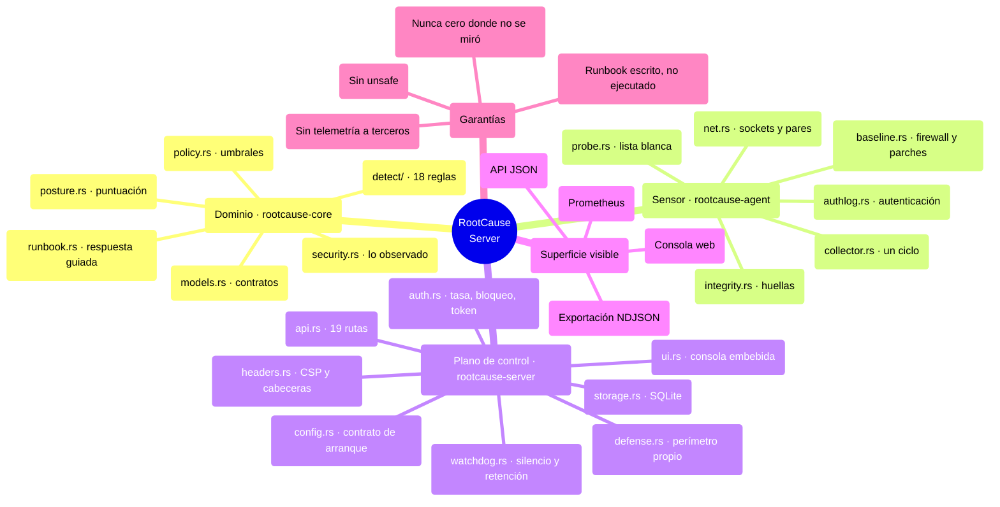
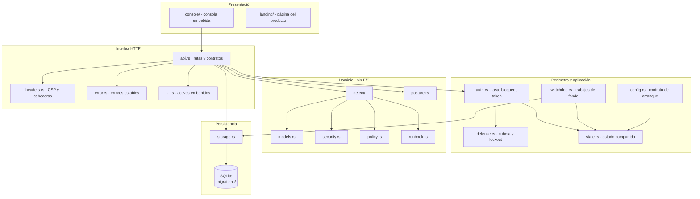
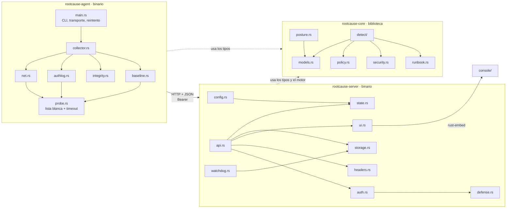
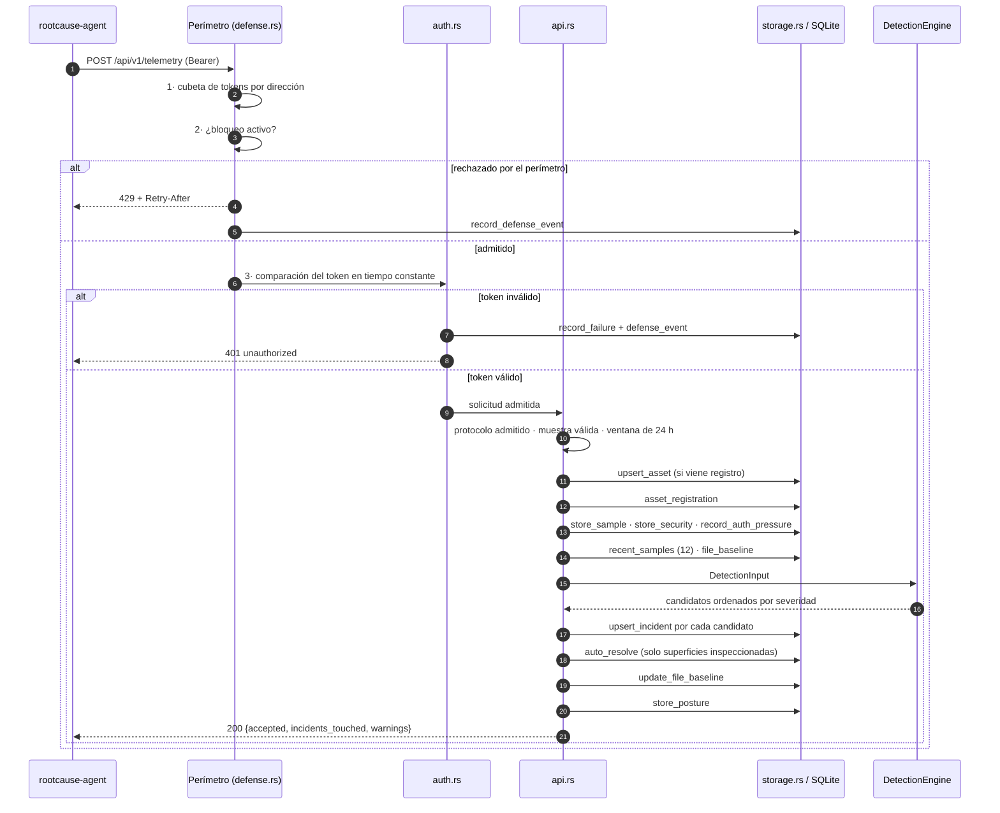
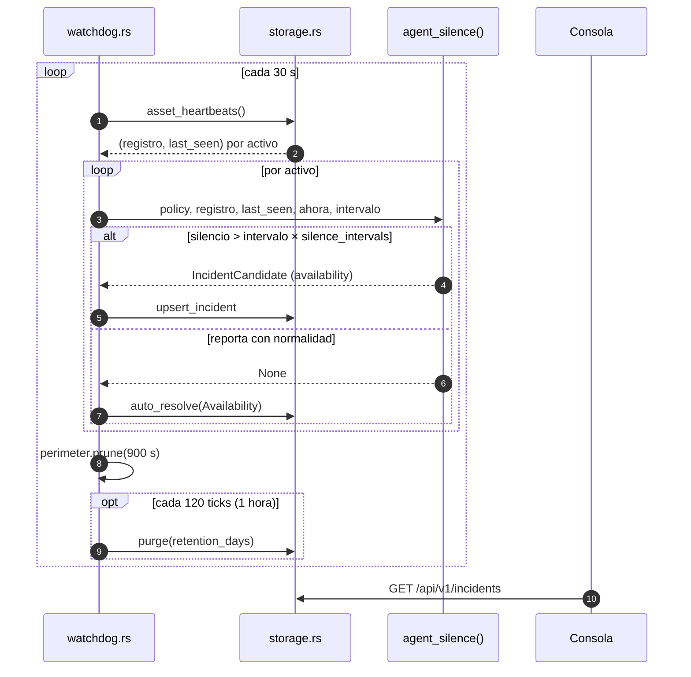
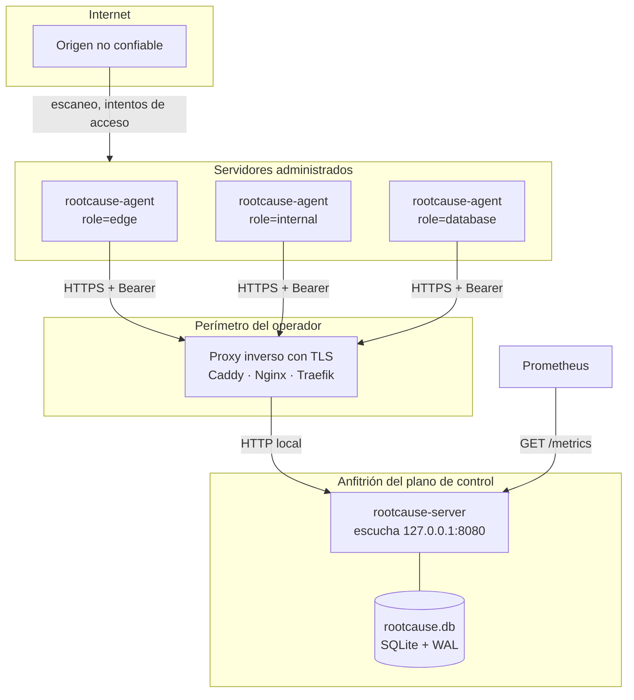
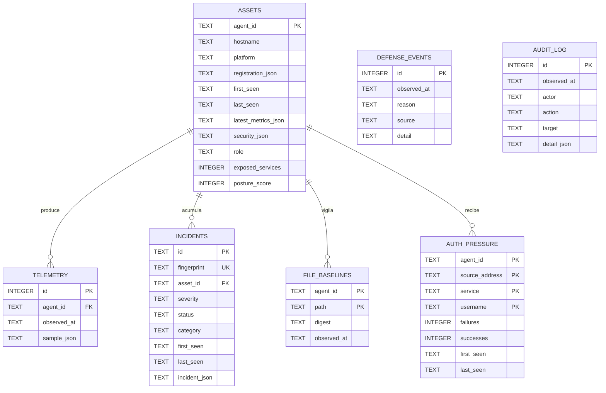

# 03 · Arquitectura

> Estilo arquitectónico, capas, responsabilidades, patrones y diagramas.
> Complementa —no sustituye— a [`docs/ARCHITECTURE.md`](../ARCHITECTURE.md),
> que es el documento que mantiene el equipo. Aquí se añade el mapa mental, el
> despliegue y el modelo de datos como diagramas, y se explica cada uno en texto.

## Estilo arquitectónico

Es un **núcleo funcional puro rodeado de adaptadores** —lo que suele llamarse
arquitectura hexagonal o *ports and adapters*—, desplegado como **cliente-servidor
con push**: los agentes empujan telemetría, el servidor nunca la solicita.

Tres decisiones definen la forma del sistema, y las tres están registradas como
ADR:

| ADR | Decisión | Consecuencia visible |
|---|---|---|
| [0001](../adr/0001-rust-first-cross-platform.md) | Rust en las tres plataformas | Un solo lenguaje de dominio a servidor a sensor; sin `unsafe` |
| [0002](../adr/0002-deteccion-determinista-y-politica-versionable.md) | Detección determinista y política versionable | El motor no tiene reloj ni red; los umbrales son datos, no código |
| [0003](../adr/0003-perimetro-propio-antes-del-token.md) | Perímetro propio antes del token | Límite de tasa y bloqueo se evalúan **antes** de comparar la credencial |

**La regla que sostiene todo:** `rootcause-core` no toca el mundo. Ni red, ni
archivos, ni reloj propio —recibe el instante del llamador—. Con la misma
entrada y la misma política produce exactamente la misma salida. De ahí que un
incidente sea reproducible meses después: la evidencia se guarda tal como llegó
y una regla nueva puede reevaluarla sin pedirle nada a la flota.

## Mapa mental del sistema

**Lectura.** El mapa se divide en las tres piezas de código, la superficie que
ve un operador y las cuatro garantías que el proyecto se impone y que CI
verifica. Nótese que el sensor tiene un módulo dedicado (`probe.rs`) cuyo único
propósito es concentrar toda ejecución externa en un lugar auditable.

## Capas y responsabilidades

| Capa | Responsabilidad | Qué **no** hace |
|---|---|---|
| **Presentación** | Renderizar el estado que devuelve el API | No contiene lógica de detección ni umbrales |
| **Interfaz HTTP** | Traducir HTTP a llamadas de dominio y almacenamiento; fijar cabeceras y errores | No decide severidades |
| **Perímetro y aplicación** | Decidir si una petición entra; sostener estado compartido; ejecutar trabajos periódicos | No conoce el contenido del dominio |
| **Dominio** | Modelo, política, reglas, postura y runbooks | No abre sockets, no lee archivos, no consulta el reloj |
| **Persistencia** | Guardar y consultar; deduplicar por huella; auditar | No aplica reglas |

La dependencia va siempre hacia adentro: `rootcause-server` depende de
`rootcause-core` por ruta (`path = "../rootcause-core"`), y `rootcause-core` no
depende de ninguno de los otros dos.

## Diagrama de componentes

**Lectura.** Agente y servidor comparten `rootcause-core` pero no se conocen
entre sí más allá del contrato JSON y la versión de protocolo. Toda la ejecución
de comandos del agente pasa por `probe.rs`, y toda la consola entra al binario
del servidor a través de `ui.rs`.

## Flujo principal: un ciclo de telemetría

**Lo que el diagrama hace explícito:** el orden `tasa → bloqueo → token` no es
un detalle de implementación, es el ADR 0003. Comparar el token antes del
perímetro convertiría el endpoint en un oráculo gratuito para quien esté
adivinando credenciales.

Otro detalle deliberado: `auto_resolve` corre **después** de insertar los
hallazgos y **solo** sobre las categorías cuya superficie se pudo inspeccionar
en ese ciclo (`self_healing_categories` en `api.rs`). Cerrar un hallazgo de
firewall porque el agente no pudo leer el firewall es exactamente el fallo que
REQ-SEC-003 existe para evitar.

## Secuencia: el sensor que se calló

**Por qué esta regla vive en el servidor y no en el agente:** un agente que fue
silenciado no puede reportar que fue silenciado. Es la única regla que se
dispara por **ausencia** de evidencia, y por eso `availability.rs` expone
`agent_silence` como función pública que llama el vigilante, en vez de
participar en `DetectionEngine::analyze`.

## Diagrama de despliegue

**Notas de despliegue.**

- El servidor escucha **solo en loopback por omisión**. Todo acceso remoto pasa
  por el proxy con TLS; el propio servidor no termina TLS.
- `--trust-forwarded-for` solo se activa cuando existe ese proxy, y el servidor
  rechaza la combinación contradictoria al validar la configuración.
- En Docker, el contenedor enlaza `0.0.0.0:8080` y es `compose.yml` quien
  publica el puerto exclusivamente en `127.0.0.1` del anfitrión.
- La base de datos es un archivo local. No hay réplica ni alta disponibilidad
  en esta versión: está declarado como fuera de alcance en
  [`docs/CAPABILITIES.md`](../CAPABILITIES.md).

## Modelo de datos

**Lectura.** Cuatro tablas cuelgan de `assets` con clave foránea y borrado en
cascada. `defense_events` y `audit_log` no tienen relación formal: el primero
registra lo que el plano de control rechazó en **su propio** perímetro —un
origen que ni siquiera llegó a nombrar un activo—, y el segundo es el rastro
inmutable de quién cambió qué. El detalle columna por columna está en
[07 · Base de datos](07-database.md).

## Patrones de diseño identificados

| Patrón | Dónde | Para qué |
|---|---|---|
| **Núcleo puro / adaptadores** | `rootcause-core` frente a los dos binarios | Detección reproducible y testeable sin infraestructura |
| **Strategy sobre datos** | `DetectionPolicy` inyectada en `DetectionEngine` | Cambiar umbrales sin recompilar; validarlos antes de aplicarlos |
| **Builder encadenado** | `DetectionInput::new().with_security().with_history()` | Entrada opcional sin constructores combinatorios |
| **Middleware / cadena de responsabilidad** | `auth::require_auth`, `headers::apply`, capas `tower-http` | Preocupaciones transversales fuera de cada handler |
| **Repository** | `storage::Database` | Todo el SQL en un módulo; los handlers no escriben consultas |
| **Token bucket** | `defense::Perimeter::check` | Límite de tasa suave por dirección, con `Retry-After` calculado |
| **Deduplicación por huella** | `fingerprint()` + `UNIQUE(fingerprint)` | Un hallazgo persistente es un incidente que se repite, no cien incidentes |
| **Catálogo publicado** | `RULES: &[RuleInfo]` | «Qué detecta hoy» sale del código, no de un documento que envejece |
| **Fail-closed en la clasificación** | `BindScope::classify` devuelve `Public` ante una dirección ilegible | Ante evidencia ambigua se reporta el caso peor |
| **Null object explícito** | `CollectionGap` | Distinguir «no hay nada» de «no se pudo mirar» |

## Procesos síncronos y asíncronos

**Síncrono** (dentro de la petición): validación, almacenamiento de la muestra,
lectura de historial y línea base, ejecución del motor, deduplicación,
auto-resolución, recálculo de postura y auditoría. Todo el ciclo de detección
ocurre antes de responder al agente, que por eso recibe en la respuesta el
número de incidentes tocados.

**Asíncrono / periódico** (`watchdog.rs`, tarea de Tokio lanzada en `main.rs`):

| Trabajo | Cadencia | Constante |
|---|---|---|
| Barrido de silencio de agentes | cada 30 s | `TICK` |
| Poda del perímetro en memoria | cada 30 s, olvidando entradas inactivas 900 s | `PERIMETER_IDLE` |
| Retención de datos | cada 120 ticks ≈ 1 hora | `PURGE_EVERY_TICKS` |

**En el agente:** ciclo propio cada `--interval-seconds`, con reintento
exponencial que duplica el intervalo hasta un techo de 300 s (`MAX_BACKOFF`) y
vuelve al normal en cuanto un envío tiene éxito. El bucle se cancela
limpiamente con Ctrl+C mediante `tokio::select!`.

## Manejo de estado

- **Estado persistente:** SQLite. Es la única fuente de verdad para activos,
  telemetría, incidentes, líneas base, presión de autenticación, eventos de
  defensa y auditoría.
- **Estado en memoria del servidor:** `AppState`, clonable y compartido por
  `Arc`. Contiene el pool de la base de datos, el motor, el perímetro, el
  instante de arranque, el token y los hechos inmutables del arranque
  (`Runtime`).
- **Estado del perímetro:** deliberadamente **solo en memoria**
  (`Mutex<HashMap<IpAddr, ClientState>>`). El módulo lo justifica: el perímetro
  debe sobrevivir a una ráfaga, no a un reinicio, y un reinicio es justo cuando
  un operador quiere empezar de cero. Tope de 20 000 direcciones vigiladas con
  desalojo de la más antigua.
- **Estado del navegador:** el token en `sessionStorage`, más filtros de vista
  en memoria. Nada más.
- **Estado del agente:** los manejadores de `sysinfo` se conservan entre ciclos
  para que las tasas tengan sentido; no hay estado en disco.

## Manejo de errores

Cuatro niveles, cada uno con una regla:

1. **Configuración.** `ServeSettings::validate` y `detection_policy` fallan al
   arrancar. Una política contradictoria **impide arrancar** en vez de degradar
   silenciosamente.
2. **HTTP.** `ApiError` produce un cuerpo estable
   `{error, code, retry_after_seconds?}` con códigos `bad_request`,
   `unauthorized`, `not_found`, `rate_limited`, `locked_out` e `internal`. Un
   error interno **registra la causa y no la devuelve**: hay una prueba que
   verifica que una cadena de conexión con contraseña no acaba en la respuesta.
3. **Recolección.** Todo fallo del agente se convierte en `CollectionGap` con
   su razón textual, viaja al servidor, vuelve como advertencia al agente y se
   muestra en la consola. Nunca se convierte en un cero.
4. **Trabajos de fondo.** El vigilante registra el error y sigue: una lectura
   fallida de latidos no debe detener la retención ni la poda.

## Autenticación y autorización

**Autenticación:** un único token *bearer* compartido entre la consola y todos
los agentes. Comparación en tiempo constante con `subtle::ConstantTimeEq`,
precedida por una comprobación de longitud.

**Autorización:** no existe. No hay roles, ni permisos, ni usuarios. Quien
tiene el token accede a todo el API. Está declarado como límite conocido en
[`docs/CAPABILITIES.md`](../CAPABILITIES.md) y desarrollado en
[11 · Seguridad](11-security.md).

Rutas públicas: `GET /healthz` y `GET /readyz`. Todo lo demás —incluido
`/metrics`— exige token.

## Persistencia y caché

- **Persistencia:** SQLite con WAL, claves foráneas activas, `synchronous =
  NORMAL`, hasta 8 conexiones (1 si la base es en memoria).
- **Estrategia de guardado:** el JSON original del agente se conserva íntegro
  (`sample_json`, `security_json`, `incident_json`, `registration_json`) junto a
  las columnas que la consola necesita para filtrar. Eso permite reevaluar una
  regla nueva contra evidencia vieja.
- **Caché:** no hay caché de aplicación. Al contrario, se impide:
  toda respuesta bajo `/api/` lleva `Cache-Control: no-store`, porque la
  evidencia no debe servirse desde una caché compartida. Los activos de la
  consola llevan `no-cache`.

## Procesos en segundo plano

Ya detallados en «Procesos síncronos y asíncronos». Un matiz operativo: la
retención **no borra incidentes ni auditoría**. `purge` elimina filas de
`telemetry`, `auth_pressure` y `defense_events` anteriores al corte. Los
incidentes y el registro de auditoría son la evidencia, y la evidencia no
caduca por omisión.

---

**Anterior:** [02 · Instalación y ejecución](02-installation-and-execution.md) ·
**Siguiente:** [04 · Mapa completo del código](04-code-map.md) ·
**Índice:** [README](README.md)
