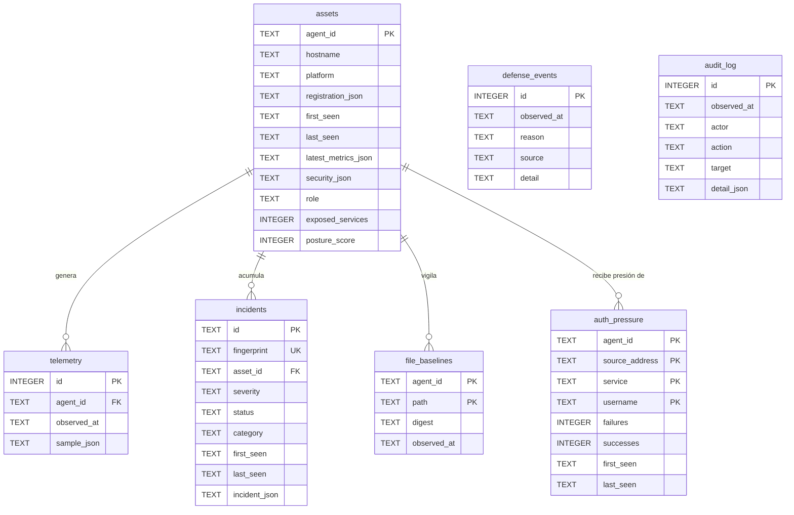

# 07 · Base de datos

> Motor, conexión, esquema completo, diccionario de datos, migraciones,
> consultas relevantes, transacciones, integridad, datos sensibles y respaldo.
> Todo verificado contra
> [`crates/rootcause-server/migrations/`](../../crates/rootcause-server/migrations/)
> y [`storage.rs`](../../crates/rootcause-server/src/storage.rs).

## Motor

| Aspecto | Valor |
|---|---|
| Motor | **SQLite**, embebido |
| Controlador | `sqlx` 0.8.6 con `default-features = false` y las features `sqlite`, `chrono`, `json`, `macros`, `migrate`, `runtime-tokio-rustls`, `uuid` |
| Otros motores | **No admitidos.** `ServeSettings::validate` rechaza cualquier URL que no empiece por `sqlite:` |
| Archivo por omisión | `rootcause.db` en el directorio de trabajo |
| En contenedor | `sqlite:///var/lib/rootcause/rootcause.db`, sobre un volumen nombrado |

No hay servidor de base de datos que instalar, configurar ni endurecer. Es una
decisión coherente con el producto: el plano de control es un binario único con
la consola dentro y un archivo al lado.

## Conexión

`Database::connect` (`storage.rs:80`) configura:

| Ajuste | Valor | Motivo |
|---|---|---|
| `create_if_missing` | `true` | No hay paso manual de creación |
| `foreign_keys` | `true` | SQLite las desactiva por omisión; aquí se exigen |
| `busy_timeout` | 10 s | Absorbe la contención entre el vigilante y las ingestas |
| `synchronous` | `NORMAL` | Compromiso habitual con WAL |
| `journal_mode` | `WAL`, salvo en base en memoria | Lecturas concurrentes durante una escritura |
| `max_connections` | 8 en archivo, **1 en memoria** | Una base en memoria por conexión sería una base distinta en cada conexión |
| `acquire_timeout` | 5 s | Falla rápido en vez de colgar una petición |

Al conectar se ejecuta `sqlx::migrate!("./migrations")`, así que las migraciones
se aplican en el arranque y quedan **embebidas en el binario**: no hay que
distribuir los `.sql` junto al ejecutable.

## Diagrama entidad-relación



**Explicación.** `assets` es la entidad central; cuatro tablas cuelgan de ella
con clave foránea y `ON DELETE CASCADE`, de modo que dar de baja un activo
arrastra su telemetría, sus incidentes, sus líneas base y su presión de
autenticación.

Las dos tablas sueltas no son un descuido:

- **`defense_events`** registra lo que el plano de control rechazó en **su
  propio** perímetro. Ese tráfico ni siquiera llegó a nombrar un activo, así
  que no puede tener clave foránea hacia `assets`.
- **`audit_log`** es un rastro genérico de acciones (actor, acción, objetivo,
  detalle). Su `target` es texto libre —hoy siempre el identificador de un
  incidente— y mantenerlo sin restricción permite auditar acciones futuras que
  no sean sobre incidentes.

## Diccionario de datos

### `assets` — inventario de equipos administrados

| Columna | Tipo | Nulo | Por omisión | Descripción |
|---|---|---|---|---|
| `agent_id` | TEXT | No | — | **PK.** UUID v5 derivado del nombre de equipo |
| `hostname` | TEXT | No | — | Nombre de equipo reportado |
| `platform` | TEXT | No | — | `windows`, `linux`, `macos`, `unknown` |
| `registration_json` | TEXT | No | — | `AssetRegistration` completo, tal cual llegó |
| `first_seen` | TEXT | No | — | RFC 3339. Primera vez que se registró |
| `last_seen` | TEXT | No | — | RFC 3339. Último latido; base del estado online/stale/offline |
| `latest_metrics_json` | TEXT | Sí | `NULL` | Última `MetricSample` |
| `security_json` | TEXT | Sí | `NULL` | Última `SecuritySignals` (añadida en 0002) |
| `role` | TEXT | No | `'internal-server'` | Rol declarado; cambia qué se considera normal (0002) |
| `exposed_services` | INTEGER | No | `0` | Contador de servicios alcanzables; alimenta `/api/v1/status` (0002) |
| `posture_score` | INTEGER | Sí | `NULL` | Última puntuación de postura del activo (0002) |

**Índices:** `idx_assets_last_seen` sobre `last_seen DESC`;
`idx_assets_platform` sobre `platform`.

**La usan:** `upsert_asset`, `asset_registration`, `list_assets`,
`asset_heartbeats`, `store_security`, `store_posture`, `counts`.

### `telemetry` — historial de muestras

| Columna | Tipo | Nulo | Descripción |
|---|---|---|---|
| `id` | INTEGER | No | **PK** autoincremental |
| `agent_id` | TEXT | No | **FK** → `assets(agent_id)`, `ON DELETE CASCADE` |
| `observed_at` | TEXT | No | RFC 3339, instante de observación **del agente** |
| `sample_json` | TEXT | No | `MetricSample` íntegra |

**Índice:** `idx_telemetry_asset_time` sobre `(agent_id, observed_at DESC)`, que
es exactamente el acceso de `recent_samples`.

**Retención:** sí. `purge` elimina las filas anteriores al corte.

### `incidents` — hallazgos deduplicados

| Columna | Tipo | Nulo | Por omisión | Descripción |
|---|---|---|---|---|
| `id` | TEXT | No | — | **PK.** UUID v4 |
| `fingerprint` | TEXT | No | — | **UNIQUE.** `{agent}:{regla}[:{clave}]` |
| `asset_id` | TEXT | No | — | **FK** → `assets(agent_id)`, cascada |
| `severity` | TEXT | No | — | `info` … `critical` |
| `status` | TEXT | No | — | `open`, `acknowledged`, `resolved` |
| `category` | TEXT | No | `'resource'` | Familia del hallazgo (0002) |
| `first_seen` | TEXT | No | — | Primera observación |
| `last_seen` | TEXT | No | — | Última observación |
| `incident_json` | TEXT | No | — | `Incident` completo: evidencia, causa, runbook, técnicas |

**Índices:** `idx_incidents_status_severity` sobre
`(status, severity, last_seen DESC)`; `idx_incidents_category` sobre
`(category, status, last_seen DESC)`.

**La restricción `UNIQUE(fingerprint)` es la deduplicación**: el mismo hallazgo
en el mismo activo no puede existir dos veces, ni siquiera si dos ciclos se
solapasen.

**Retención:** **no**. Los incidentes son la evidencia y no caducan.

### `audit_log` — rastro inmutable

| Columna | Tipo | Nulo | Descripción |
|---|---|---|---|
| `id` | INTEGER | No | **PK** autoincremental |
| `observed_at` | TEXT | No | RFC 3339 |
| `actor` | TEXT | No | `rootcause-engine`, o el actor de la petición |
| `action` | TEXT | No | `incident.auto_resolved`, `incident.status_changed` |
| `target` | TEXT | No | Identificador afectado |
| `detail_json` | TEXT | No | Contexto en JSON |

**Índice:** `idx_audit_time` sobre `observed_at DESC`.
**Retención:** **no**. Nada borra esta tabla.

### `file_baselines` — última huella conocida por archivo

| Columna | Tipo | Nulo | Descripción |
|---|---|---|---|
| `agent_id` | TEXT | No | **PK compuesta** + **FK** → `assets`, cascada |
| `path` | TEXT | No | **PK compuesta.** Ruta vigilada |
| `digest` | TEXT | No | SHA-256 hexadecimal |
| `observed_at` | TEXT | No | Cuándo se registró esta huella |

La clave primaria compuesta `(agent_id, path)` es lo que hace que **un cambio se
detecte exactamente una vez**: al actualizar la huella, la siguiente comparación
parte del valor nuevo.

**Contiene contenido de archivo:** no. Solo la huella.

### `auth_pressure` — presión de autenticación agregada

| Columna | Tipo | Nulo | Por omisión | Descripción |
|---|---|---|---|---|
| `agent_id` | TEXT | No | — | **PK compuesta** + **FK** → `assets`, cascada |
| `source_address` | TEXT | No | — | **PK compuesta.** Dirección de origen |
| `service` | TEXT | No | — | **PK compuesta.** Servicio atacado (`sshd`, …) |
| `username` | TEXT | No | `''` | **PK compuesta.** Usuario probado; vacío si no se conoce |
| `failures` | INTEGER | No | `0` | Intentos fallidos acumulados |
| `successes` | INTEGER | No | `0` | Accesos concedidos acumulados |
| `first_seen` | TEXT | No | — | Primera observación |
| `last_seen` | TEXT | No | — | Última observación |

**Índice:** `idx_auth_pressure_source` sobre `(source_address, last_seen DESC)`,
que es el acceso de `threat_sources`.

**Retención:** sí, por `last_seen`.

### `defense_events` — lo que rechazó el propio perímetro

| Columna | Tipo | Nulo | Por omisión | Descripción |
|---|---|---|---|---|
| `id` | INTEGER | No | — | **PK** autoincremental |
| `observed_at` | TEXT | No | — | RFC 3339 |
| `reason` | TEXT | No | — | `rate.limit`, `auth.lockout`, `auth.rejected` |
| `source` | TEXT | No | — | Dirección rechazada |
| `detail` | TEXT | No | `''` | Contexto textual |

**Índices:** `idx_defense_events_time` sobre `observed_at DESC`;
`idx_defense_events_reason` sobre `(reason, observed_at DESC)`.

**Retención:** sí.

## Migraciones

| Archivo | Aporta | Compatibilidad |
|---|---|---|
| [`0001_init.sql`](../../crates/rootcause-server/migrations/0001_init.sql) | `assets`, `telemetry`, `incidents`, `audit_log` y sus índices | Base inicial 0.1.0 |
| [`0002_security_surface.sql`](../../crates/rootcause-server/migrations/0002_security_surface.sql) | 4 columnas en `assets`, `category` en `incidents`, y las tablas `file_baselines`, `auth_pressure`, `defense_events` | **Hacia adelante.** Toda columna añadida es nullable o tiene valor por omisión, así que una base creada por 0.1.0 sigue funcionando |

El propio archivo `0002` documenta esa promesa en su cabecera. La otra mitad de
la compatibilidad está en el código: `Incident.category` lleva
`#[serde(default = "default_category")]`, de modo que un `incident_json`
almacenado por 0.1.0 —que no tenía categoría— se deserializa sin error.

**Reversión:** no hay migraciones descendentes. Volver a una versión anterior
del binario requiere restaurar un respaldo del archivo. *Requiere validación*
por parte de quien opere el despliegue.

**Datos semilla:** no hay. La base arranca vacía y se puebla con el primer
registro de agente.

## Consultas relevantes

| Consulta | Función | Patrón |
|---|---|---|
| Alta o actualización de activo | `upsert_asset` | `INSERT … ON CONFLICT(agent_id) DO UPDATE` |
| Últimas N muestras de un activo | `recent_samples` | `WHERE agent_id = ? AND observed_at < ? ORDER BY observed_at DESC LIMIT ?`, invertida en memoria |
| Alta o actualización de incidente | `upsert_incident` | `SELECT` por huella + `INSERT … ON CONFLICT(fingerprint) DO UPDATE` |
| Cierre automático | `auto_resolve` | `SELECT` de los no resueltos + `UPDATE` fila a fila con auditoría |
| Listado filtrado | `list_incidents` | SQL construido por partes con parámetros enlazados |
| Orígenes que presionan | `threat_sources` | Agregación sobre `auth_pressure` con `GROUP BY source_address` |
| Cifras de cabecera | `counts` | Seis `COUNT`/`SUM` independientes |
| Contadores de defensa | `defense_counters` | `GROUP BY reason` con `COUNT` y `MAX(observed_at)` |
| Retención | `purge` | Tres `DELETE … WHERE fecha < corte` |

**Sobre inyección SQL.** `list_incidents` construye el texto de la consulta de
forma incremental, pero **solo añade fragmentos constantes** (`" AND status = ?"`)
y enlaza los valores como parámetros. Ningún dato de entrada se interpola en el
texto de la consulta. Ver [11 · Seguridad](11-security.md).

## Transacciones

Hay **dos transacciones explícitas**, ambas en operaciones que escriben muchas
filas de golpe:

| Función | Archivo | Qué agrupa |
|---|---|---|
| `update_file_baseline` | `storage.rs:270` | Un `INSERT … ON CONFLICT` por archivo vigilado |
| `record_auth_pressure` | `storage.rs:302` | Un `INSERT … ON CONFLICT` por evento de autenticación |

El resto de escrituras se ejecuta cada una en su propia transacción implícita
de SQLite.

Consecuencia real, y es un riesgo identificado: **la ingesta completa de un
sobre no es atómica**. Realiza entre 6 y 10 escrituras sucesivas (muestra,
superficie, presión, incidentes, cierre automático, línea base, postura); si el
proceso muere a mitad, quedan aplicadas las primeras y no las últimas. El caso
más molesto sería una línea base de archivos actualizada sin que el incidente
correspondiente se guardara, lo que perdería un cambio.

En la práctica el orden mitiga el problema —`update_file_baseline` va después
de `upsert_incident`—, pero la atomicidad del ciclo no está garantizada.
Recogido en [15 · Riesgos y deuda técnica](15-risks-and-technical-debt.md).

## Integridad de los datos

| Mecanismo | Dónde | Qué garantiza |
|---|---|---|
| Claves foráneas activas | `foreign_keys(true)` al conectar | No hay telemetría ni incidentes huérfanos |
| `ON DELETE CASCADE` | Cuatro tablas hijas | Borrar un activo limpia todo lo suyo |
| `UNIQUE(fingerprint)` | `incidents` | Deduplicación garantizada por el esquema |
| Claves primarias compuestas | `file_baselines`, `auth_pressure` | Una fila por (activo, ruta) y por (activo, origen, servicio, usuario) |
| Validación previa | `MetricSample::validate`, `validate_asset`, `validate_security` | Nada imposible o desmedido llega a la base |
| `NOT NULL` con valor por omisión | Columnas de 0002 | Actualización sin migración de datos |

## Datos sensibles almacenados

| Dato | Tabla / columna | Sensibilidad | Mitigación |
|---|---|---|---|
| Nombres de equipo | `assets.hostname` | Baja–media | Necesario para identificar el activo |
| **Direcciones IP de origen** | `auth_pressure.source_address`, `defense_events.source` | **Media–alta.** Puede ser dato personal según jurisdicción | Sujeto a retención (30 días por omisión) |
| **Nombres de usuario probados** | `auth_pressure.username` | **Media.** Revela qué cuentas existen o se intentaron | Sujeto a retención |
| Rutas de archivos vigilados | `file_baselines.path` | Baja | Solo rutas, nunca contenido |
| Huellas de archivos | `file_baselines.digest`, dentro de `incident_json` | Baja | SHA-256; prueba el cambio, no revela el contenido |
| Nombres de proceso y PID | Dentro de `security_json` | Baja–media | Ayuda a atribuir un puerto abierto |
| Etiquetas del activo | `assets.registration_json` | Depende del operador | Lo que el operador ponga en `--label` |

**Lo que NO se almacena:** contenido de archivos, líneas de registro en crudo,
contraseñas, tokens, cabeceras de peticiones, ni cuerpos de tráfico. El agente
agrega antes de enviar precisamente para que las líneas crudas no salgan del
equipo. Detalle en
[`docs/POLITICA_DE_PRIVACIDAD_LOCAL.md`](../POLITICA_DE_PRIVACIDAD_LOCAL.md).

**El token del API no está en la base de datos.** Vive en la configuración del
proceso (`ROOTCAUSE_API_TOKEN`) y en `AppState` como `Arc<str>`.

## Retención

`purge(retention_days)`, ejecutada por el vigilante cada ≈ 1 hora:

| Tabla | ¿Se poda? | Criterio |
|---|---|---|
| `telemetry` | Sí | `observed_at < corte` |
| `auth_pressure` | Sí | `last_seen < corte` |
| `defense_events` | Sí | `observed_at < corte` |
| `assets` | No | El inventario no caduca |
| `incidents` | **No** | Es la evidencia |
| `audit_log` | **No** | Es la evidencia |
| `file_baselines` | No | Se sobrescribe, no se acumula |

Por omisión son 30 días (`ROOTCAUSE_RETENTION_DAYS`), con rango válido de 1 a
3 650.

## Respaldo y recuperación

**Estado en el repositorio:** [`scripts/backup.sh`](../../scripts/backup.sh)
—y [`scripts/backup.ps1`](../../scripts/backup.ps1) en Windows—.

```bash
bash scripts/backup.sh /var/lib/rootcause/rootcause.db /respaldo
```

Qué hace, y por qué así:

| Paso | Motivo |
|---|---|
| `sqlite3 … ".backup '<destino>'"` | Seguro con la base en uso. Copiar con `cp` mientras el servidor escribe puede producir una instantánea rota si no viajan también `-wal` y `-shm` |
| `PRAGMA integrity_check` sobre la copia | Un archivo del tamaño correcto puede estar corrupto |
| Recuento de `incidents`, `audit_log` y `assets` contra el origen | Lo que importa no es que la copia abra, sino que la evidencia esté dentro |
| Retención de las N más recientes | `ROOTCAUSE_BACKUP_KEEP`, 14 por omisión |

Si cualquiera de las comprobaciones falla, el script termina con código 1 en vez
de informar de un éxito: **un respaldo que nadie leyó de vuelta es una
esperanza, no un respaldo**.

Restauración —el script la imprime al terminar—: detener el servicio, colocar el
archivo en la ruta de `ROOTCAUSE_DATABASE_URL`, borrar los `-wal` y `-shm` que
queden, arrancar. Las migraciones pendientes se aplican solas.

**Sigue siendo responsabilidad de quien opera** programar la ejecución, llevarse
las copias fuera del anfitrión y probar una restauración real. El volumen
`rootcause-data` de `compose.yml` preserva el archivo entre recreaciones del
contenedor, pero **un volumen no es un respaldo**.

## Relación entre tablas y código

| Tabla | Módulos que la tocan | Endpoints que la exponen |
|---|---|---|
| `assets` | `storage`, `api`, `watchdog` | `/api/v1/assets`, `/api/v1/assets/{id}`, `/api/v1/status`, `/api/v1/exposure`, `/api/v1/topology`, `/metrics` |
| `telemetry` | `storage`, `api` | `/api/v1/assets/{id}` (historial) |
| `incidents` | `storage`, `api`, `watchdog` | `/api/v1/incidents*`, `/api/v1/status`, `/api/v1/topology`, `/api/v1/export`, `/metrics` |
| `audit_log` | `storage` | `/api/v1/audit`, `/api/v1/export` |
| `file_baselines` | `storage`, `api` | Ninguno directo; alimenta `integrity.file.changed` |
| `auth_pressure` | `storage`, `api` | `/api/v1/threats` |
| `defense_events` | `storage`, `state`, `auth` | `/api/v1/threats` (`control_plane_defense`), `/api/v1/status`, `/metrics` |

---

**Anterior:** [06 · Explicación profunda del código](06-deep-code-explanation.md) ·
**Siguiente:** [08 · Flujo de datos](08-data-flow.md) ·
**Índice:** [README](README.md)
