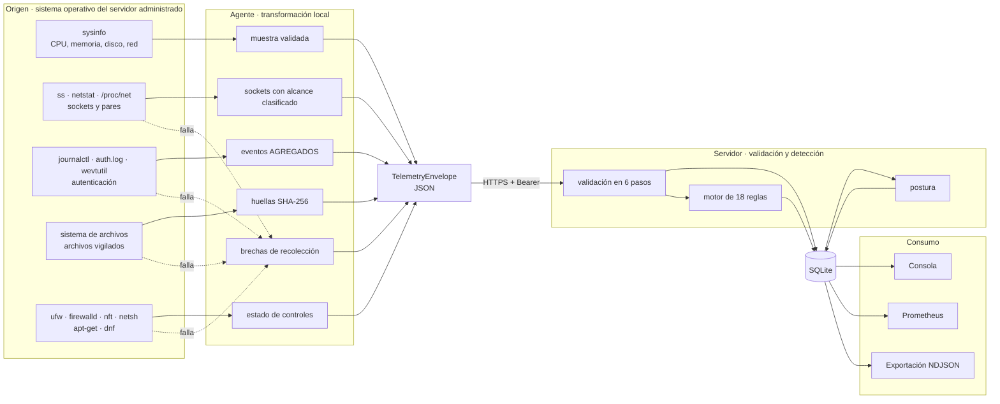

# 08 · Flujo de datos

> De dónde viene cada dato, cómo se valida, cómo se transforma, dónde se
> almacena, quién lo consume, qué sale hacia fuera y dónde puede perderse o
> volverse inconsistente. Incluye qué datos personales se procesan.

## Panorama



**Lectura.** Las flechas de puntos son la parte del diseño que distingue a este
producto: **cada fuente que falla produce una brecha explícita**, no un hueco
silencioso. Esa brecha viaja en el mismo sobre, se almacena con la superficie,
vuelve al agente como advertencia y aparece en la consola.

## 1 · De dónde provienen los datos

| Dato | Fuente | Módulo | Plataformas |
|---|---|---|---|
| CPU, memoria, disco, red, uptime, procesos | Biblioteca `sysinfo` | `collector.rs` | Las tres |
| Sockets en escucha y pares conectados | `ss -tunaH`; respaldo `/proc/net/*`; `netstat` | `net.rs` | Linux / Windows / macOS |
| Intentos de autenticación | `journalctl … _COMM=sshd`; respaldo `/var/log/auth.log` o `/var/log/secure`; `wevtutil` eventos 4625 y 4624 | `authlog.rs` | Linux y Windows |
| Huellas de archivos | Lectura directa del sistema de archivos | `integrity.rs` | Las tres |
| Estado del firewall | `ufw status verbose`, `firewall-cmd --state`, `nft list ruleset`, `netsh advfirewall`, `socketfilterfw` | `baseline.rs` | Las tres |
| Parches pendientes | `apt-get --simulate upgrade`, `dnf check-update --security` | `baseline.rs` | Solo Linux |
| Identidad del equipo | `System::host_name()`, `std::env::consts::ARCH`, versión del binario | `collector.rs` | Las tres |
| Rol y entorno | Etiquetas `--label` que declara el operador | `main.rs` | Las tres |
| Instante de recepción | Reloj del servidor | `api.rs` | — |
| Dirección del cliente | Socket, o `X-Forwarded-For` si hay proxy declarado | `auth.rs` | — |

**Nada se descubre activamente.** El agente no escanea la red, no sondea otros
equipos y no abre conexiones salientes salvo hacia su propio plano de control.

## 2 · Cómo se validan

La validación ocurre **tres veces**, en tres lugares distintos:

### En el agente, antes de enviar

| Comprobación | Dónde | Efecto si falla |
|---|---|---|
| Esquema de la URL del servidor | `validate_transport` | El agente **no arranca** |
| Longitud del token ≥ 32 | `main.rs` | El agente **no arranca** |
| Formato de etiqueta `clave=valor`, clave ≤ 64, valor ≤ 256 | `parse_label` | Error de línea de comandos |
| `MetricSample::validate` | `Collector::sample` | Error del ciclo; no se envía |
| Tamaño de archivo ≤ 8 MiB | `integrity.rs` | Se convierte en brecha |
| Tope de 256 sockets / 512 pares / 200 eventos | `net.rs`, `authlog.rs` | Se recorta **y se declara la brecha** |

### En el servidor, al recibir

Orden exacto de `ingest_telemetry`:

1. **Versión de protocolo** contra `SUPPORTED_PROTOCOL_VERSIONS` (`1.0`, `1.1`).
2. **`MetricSample::validate`**: porcentajes finitos entre 0 y 100.
3. **Ventana temporal**: `observed_at` no más de 5 minutos en el futuro ni más
   de 24 horas en el pasado.
4. **`validate_asset`**: nombre de equipo 1–255; versión y arquitectura no
   vacías y ≤ 50; ≤ 32 etiquetas con claves ≤ 64 y valores ≤ 256.
5. **Coincidencia de identidad**: `asset.agent_id == sample.agent_id`.
6. **`validate_security`**: ≤ 1 024 sockets, ≤ 4 096 pares, ≤ 1 024 eventos de
   autenticación, ≤ 512 archivos vigilados, ≤ 64 brechas; direcciones y
   servicios ≤ 64 caracteres, usuarios ≤ 128, rutas ≤ 512, huellas ≤ 128.

Además, antes de llegar al handler, actúan las capas transversales: límite de
cuerpo (`--max-body-kib`, 1 MiB por omisión) y tiempo de espera de 30 s.

### En la base de datos

Claves foráneas activas, `UNIQUE(fingerprint)`, claves primarias compuestas y
columnas `NOT NULL`.

## 3 · Cómo se transforman

Cinco transformaciones cambian la naturaleza del dato, no solo su formato:

| Transformación | Dónde | De qué a qué |
|---|---|---|
| **Agregación de autenticación** | `authlog::aggregate` | Líneas de registro → filas `(servicio, origen, usuario, resultado, cuenta)`. **Las líneas crudas no salen del equipo** |
| **Huella de archivo** | `integrity::digest` | Contenido → SHA-256. Prueba el cambio, no revela el contenido |
| **Clasificación de alcance** | `BindScope::classify` | Texto de dirección → `loopback` / `private` / `public` |
| **Clasificación de puerto** | `port_profile` | Número → servicio y clase de riesgo |
| **Evidencia → hallazgo** | `detect/*` | Observaciones + política → `IncidentCandidate` con severidad, causa y runbook |

Y tres agregaciones en el servidor:

| Agregación | Dónde | Resultado |
|---|---|---|
| Deduplicación por huella | `merge_by_fingerprint` + `upsert_incident` | Un hallazgo persistente es un incidente con más ocurrencias |
| Presión por origen en toda la flota | `threat_sources` | `ThreatSource` con servicios, usuarios y activos afectados |
| Postura | `posture::compute` | Seis dimensiones + puntuación con techo + superficies no inspeccionadas |

## 4 · Dónde se almacena

| Dato | Destino | Retención |
|---|---|---|
| Registro del activo | `assets.registration_json` | Permanente |
| Muestra de recursos | `telemetry.sample_json` **y** `assets.latest_metrics_json` | Historial podado; la última siempre disponible |
| Superficie de seguridad | `assets.security_json` (solo la última) | Se sobrescribe cada ciclo |
| Huellas de archivos | `file_baselines` | Se sobrescribe por (activo, ruta) |
| Presión de autenticación | `auth_pressure` | Podada |
| Incidentes | `incidents.incident_json` | **Permanente** |
| Auditoría | `audit_log` | **Permanente** |
| Rechazos del perímetro | `defense_events` | Podada |
| Estado del perímetro | **Memoria del proceso** | Se pierde al reiniciar, a propósito |
| Token de la consola | `sessionStorage` del navegador | Se pierde al cerrar la pestaña |

**Nota sobre la superficie de seguridad:** solo se conserva la **última**. No
hay historial de sockets abiertos. La consecuencia es que la vista de superficie
responde «qué hay ahora», no «qué hubo el martes». Recogido en
[15 · Riesgos](15-risks-and-technical-debt.md).

## 5 · Qué componentes consumen los datos

| Consumidor | Qué lee | Por dónde |
|---|---|---|
| Consola | Todo el API JSON | `fetch` cada 10 s |
| Prometheus | Cifras agregadas | `GET /metrics` |
| Orquestador / systemd | Vida y disponibilidad | `GET /healthz`, `GET /readyz` |
| Auditor | Activos, incidentes y auditoría | `GET /api/v1/export` (NDJSON) |
| Agente | Confirmación y advertencias | Respuesta de `POST /api/v1/telemetry` |
| Motor de detección | Muestra, superficie, historial y línea base | En proceso |
| Vigilante | Latidos y retención | En proceso |

## 6 · Qué se envía a servicios externos

**Nada.**

| Destino | Se envía |
|---|---|
| Fabricante del producto | Nada |
| Analítica, telemetría de uso, informes de error | Nada |
| CDN, fuentes web, bibliotecas remotas | Nada. La consola no carga un solo recurso externo, y `guard_console.py` hace fallar el build si alguien lo intenta |
| Servicios de reputación de IP o inteligencia de amenazas | Nada |

Las únicas conexiones salientes del sistema son:

1. **Agente → plano de control del operador.** HTTPS con token, o HTTP hacia
   loopback.
2. **Consola → su propio servidor.** Mismo origen, forzado por la CSP
   `connect-src 'self'`.

El `README.md` lo declara con una insignia («telemetría a terceros: cero») y
[`docs/POLITICA_DE_PRIVACIDAD_LOCAL.md`](../POLITICA_DE_PRIVACIDAD_LOCAL.md) lo
desarrolla.

## 7 · Qué se presenta al usuario

| Vista de la consola | Datos |
|---|---|
| Panel | Postura con sus dimensiones y sus superficies no inspeccionadas, métricas de cabecera, incidentes recientes, orígenes principales |
| Superficie expuesta | Tabla de servicios alcanzables con equipo, puerto, servicio, alcance y severidad; y los equipos **no inspeccionados** |
| Amenazas | Orígenes con fallos y éxitos, servicios y usuarios probados; contadores de defensa del propio plano de control |
| Incidentes | Lista filtrable; al abrir uno, evidencia, causa raíz, confianza, acciones y runbook |
| Activos | Inventario con plataforma, rol, estado, postura y última señal |
| Topología | Grafo por zonas: Internet, superficie expuesta, red interna |
| Reglas | Catálogo de 18 reglas con su pregunta y su mapeo ATT&CK |
| Sistema | Versión, protocolo, endurecimiento, política vigente y auditoría |

**Un aviso permanente** aparece cuando `hardening` declara algo que debilita la
postura: sin autenticación, o escuchando fuera de loopback.

## 8 · Ejemplo de flujo principal

Datos ficticios; ninguna dirección es real (rangos de documentación RFC 5737).

**Ciclo 1 — el agente reporta un PostgreSQL público.**

Lo que el agente envía (recortado):

```json
{
  "protocol_version": "1.1",
  "asset": {
    "agent_id": "8f14e45f-ceea-5e78-9d2b-7f4a1c2b3d40",
    "hostname": "srv-db-01",
    "platform": "linux",
    "architecture": "x86_64",
    "agent_version": "0.2.0",
    "labels": { "role": "database", "environment": "production" }
  },
  "sample": {
    "agent_id": "8f14e45f-ceea-5e78-9d2b-7f4a1c2b3d40",
    "observed_at": "2026-08-26T12:00:00Z",
    "cpu_percent": 11.5, "memory_percent": 42.0, "disk_percent": 63.0,
    "uptime_seconds": 864000,
    "network_rx_bytes": 91234567, "network_tx_bytes": 45678901
  },
  "security": {
    "listeners": [
      { "protocol": "tcp", "address": "0.0.0.0", "port": 5432,
        "scope": "public", "process": "postgres", "pid": 1204 }
    ],
    "auth_events": [
      { "service": "sshd", "source_address": "203.0.113.10",
        "username": "root", "outcome": "failure", "count": 47,
        "last_seen": "2026-08-26T11:59:40Z" }
    ],
    "collection_gaps": [
      { "surface": "security-updates",
        "reason": "no se encontró apt-get ni dnf para consultar actualizaciones" }
    ]
  }
}
```

Lo que ocurre dentro:

1. `BindScope::classify("0.0.0.0")` → `Public`.
2. `port_profile(5432)` → PostgreSQL, clase `Database`.
3. `exposure_severity(Database, Public, DatabaseServer)` → **`Critical`**.
4. Se emite `exposure.service.public` con huella
   `8f14e45f-…:exposure.service.public:tcp/5432` y el runbook de
   `restrict_listener` para Linux.
5. 47 fallos ≥ `failures_per_source_high` (20) → `intrusion.auth.bruteforce`
   con severidad `High` y el runbook de `block_source`.
6. `self_healing_categories` devuelve `[Exposure]`: hay brecha en
   `security-updates`, así que **la higiene no se auto-resuelve**.
7. La postura del activo cae; el techo por hallazgo crítico la limita a 55 % de
   la media ponderada.

Lo que el agente recibe:

```json
{
  "accepted": true,
  "incidents_touched": 2,
  "warnings": [
    "superficie no inspeccionada — security-updates: no se encontró apt-get ni dnf para consultar actualizaciones"
  ]
}
```

**Ciclo 2 — el mismo estado, un minuto después.** Las mismas dos huellas.
`upsert_incident` incrementa `occurrences` a 2 y refresca `last_seen`. **No se
crean incidentes nuevos.**

**Ciclo 3 — el operador restringe el puerto a loopback.** El socket ahora se
clasifica `Loopback`, `exposure_severity` devuelve `Info` y no se emite ningún
candidato de exposición. Como `listeners` **sí** se inspeccionó,
`self_healing_categories` incluye `Exposure`, y `auto_resolve` cierra el
incidente y escribe una entrada de auditoría con el motivo. El hallazgo de
autenticación **sigue abierto**: describe algo que ocurrió.

**Ciclo 4 — el mismo origen consigue entrar.** Llega un `AuthEvent` con
`outcome: "success"` desde `203.0.113.10`, que ya acumulaba 47 fallos. Se
dispara `intrusion.auth.success_after_burst` con severidad **crítica**. Esta es
la correlación por la que existe el producto: dos hechos que ningún registro
del sistema guarda juntos.

## 9 · Dónde pueden producirse errores, pérdidas o inconsistencias

| Punto | Qué puede pasar | Mitigación existente | Riesgo residual |
|---|---|---|---|
| Sonda del agente | El comando falta, falla o expira | Se emite `CollectionGap` con la razón | Ninguno: la brecha es visible |
| Recorte por topes | Más de 256 sockets o 512 pares | Se recorta **y se declara la brecha** | Los sockets recortados no se evalúan |
| Envío | Red caída o servidor no disponible | Reintento exponencial hasta 300 s | **El ciclo perdido no se reenvía**: no hay cola local |
| Ventana temporal | Reloj del agente desviado > 24 h | Se rechaza con `400` | La muestra se pierde; aparece hallazgo de reloj |
| Ingesta parcial | El proceso muere a mitad del ciclo | Orden pensado: la línea base se actualiza al final | **La ingesta no es atómica** |
| Auto-resolución | Cerrar un hallazgo por falta de inspección | `self_healing_categories` lo impide | Ninguno para exposición e higiene |
| Retención | Se pierde historial anterior al corte | Incidentes y auditoría **no** se podan | La telemetría antigua desaparece |
| Superficie histórica | Solo se guarda la última | — | **No se puede reconstruir la superficie de una fecha pasada** |
| Colisión de identidad | Dos equipos con el mismo `hostname` | — | **Comparten activo.** Ver [15](15-risks-and-technical-debt.md) |
| Reinicio del servidor | Se pierde el estado del perímetro | Decisión deliberada | Un bloqueo en curso se levanta |

## 10 · Datos personales y sensibles

| Dato | ¿Personal? | Dónde vive | Retención | Justificación |
|---|---|---|---|---|
| **Dirección IP de origen** | Sí en varias jurisdicciones (RGPD la trata como dato personal) | `auth_pressure.source_address`, `defense_events.source`, dentro de `incident_json` | 30 días por omisión en las tablas; **permanente** dentro de un incidente | Sin la dirección no se puede distinguir una ráfaga de un usuario despistado |
| **Nombre de usuario probado** | Sí, potencialmente | `auth_pressure.username`, dentro de `incident_json` | Igual que la anterior | Es la diferencia entre una clave olvidada y un barrido con lista |
| Nombre de equipo | Normalmente no | `assets.hostname` | Permanente | Identifica el activo |
| Nombre de proceso y PID | No | Dentro de `security_json` | Última superficie | Atribuye un puerto abierto a un servicio |
| Rutas de archivo | No | `file_baselines.path` | Permanente | Solo rutas |
| Etiquetas del activo | Depende de lo que ponga el operador | `assets.registration_json` | Permanente | Definidas por quien despliega |

**Puntos a favor del diseño:**

- El agente **agrega antes de enviar**: las líneas de registro, que sí
  contendrían datos adicionales, nunca salen del equipo.
- Se envían **huellas, no contenidos**: un `/etc/shadow` vigilado no revela un
  solo hash de contraseña.
- **No hay telemetría a terceros**: el dato personal no sale del despliegue del
  operador.
- La retención es configurable de 1 a 3 650 días.

**Punto a vigilar:** una dirección IP y un nombre de usuario incrustados en el
JSON de un incidente **no se podan**, porque los incidentes son permanentes. Si
el marco legal aplicable exige suprimir una dirección concreta, hoy hay que
hacerlo a mano sobre la base de datos. *Requiere validación* jurídica según la
jurisdicción del operador, y está recogido en
[15 · Riesgos](15-risks-and-technical-debt.md).

---

**Anterior:** [07 · Base de datos](07-database.md) ·
**Siguiente:** [09 · APIs e integraciones](09-apis-and-integrations.md) ·
**Índice:** [README](README.md)
