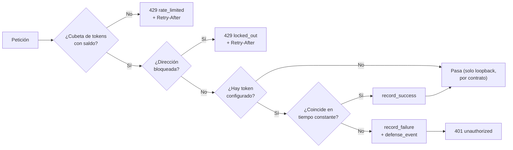

# 11 · Seguridad

> Autenticación, autorización, sesiones, validación, cifrado, secretos,
> auditoría, dependencias, superficie de ataque, controles implementados y
> **controles ausentes o no comprobados**.
>
> Complementa a [`docs/THREAT_MODEL.md`](../THREAT_MODEL.md),
> [`docs/HARDENING.md`](../HARDENING.md) y
> [`docs/SECURITY_REQUIREMENTS.md`](../SECURITY_REQUIREMENTS.md).
>
> No se realizaron pruebas destructivas ni ataques contra ningún sistema. Este
> documento es una revisión de código y configuración.

## Resumen para un auditor

| Área | Veredicto | Detalle |
|---|---|---|
| Autenticación | **Implementada**, simple | Token bearer único, comparación en tiempo constante |
| Autorización | **Ausente por diseño** | No hay roles ni permisos; está declarado como límite conocido |
| Perímetro propio | **Implementado y probado** | Límite de tasa y bloqueo **antes** de comparar la credencial |
| Validación de entrada | **Implementada y exhaustiva** | Seis pasos en la ingesta más límites por campo |
| Inyección SQL | **No explotable** | Parámetros enlazados en todas las consultas |
| XSS en la consola | **Mitigado en dos capas** | CSP sin `unsafe-inline` + construcción del DOM sin cadenas, verificado por un guardián de CI |
| Gestión de secretos | **Correcta** | Solo por entorno; nunca se registran; `gitleaks` sobre el histórico |
| Cifrado en tránsito | **Delegado** | El servidor no termina TLS; va tras un proxy |
| Cifrado en reposo | **Ausente** | El archivo SQLite no está cifrado |
| Auditoría | **Implementada** | Rastro inmutable que no se poda |
| Dependencias | **Gestionadas activamente y verificadas** | `cargo deny` y `cargo audit` ejecutados aquí, ambos limpios; más SBOM y Dependabot |
| `unsafe` | **Prohibido** | `unsafe_code = "forbid"` en todo el workspace |

## Autenticación

**Mecanismo:** un único token *bearer* compartido entre la consola y todos los
agentes.

```rust
fn tokens_match(supplied: &str, expected: &str) -> bool {
    supplied.len() == expected.len() && bool::from(supplied.as_bytes().ct_eq(expected.as_bytes()))
}
```

| Control | Implementación |
|---|---|
| Longitud mínima | 32 caracteres, verificada al arrancar |
| Espacios envolventes | Rechazados al arrancar |
| Generación | `rootcause-server token`: dos UUID v4 concatenados, 64 caracteres hexadecimales |
| Comparación | `subtle::ConstantTimeEq`, precedida de comprobación de longitud |
| Esquema | Solo `Bearer`; `Basic` se ignora; un `Bearer` sin valor se rechaza |
| Exposición en la ayuda | `hide_env_values = true` en `clap` |
| Almacenamiento en el servidor | `Arc<str>` en `AppState`; **nunca en la base de datos** |
| Almacenamiento en el navegador | `sessionStorage`, no `localStorage` |
| Registro | Nunca. Regla explícita de `AGENTS.md` |

**Entropía.** Dos UUID v4 aportan 122 bits aleatorios cada uno; el token
resultante tiene del orden de 244 bits de entropía. Adivinarlo por fuerza bruta
no es viable, y el bloqueo tras 10 fallos lo hace además ruidoso.

### Debilidades conocidas de este modelo

| Debilidad | Impacto | Estado |
|---|---|---|
| **Un solo token para todo** | Quien lo tenga puede leer todo el API y publicar telemetría como cualquier agente | Declarado como límite en [`docs/CAPABILITIES.md`](../CAPABILITIES.md) |
| **Sin rotación** | Cambiar el token exige reconfigurar servidor y todos los agentes a la vez | *No documentado en el repositorio* un procedimiento de rotación |
| **Sin caducidad** | El token vive hasta que alguien lo cambia | Igual |
| **Mismo token para leer y escribir** | Un agente comprometido puede leer los incidentes de toda la flota | Igual |

## Autorización

**No existe.** No hay usuarios, roles ni permisos. Cualquier portador del token
puede:

- leer el inventario completo, la superficie, las amenazas y los incidentes;
- cambiar el estado de cualquier incidente;
- registrar activos y publicar telemetría en nombre de cualquiera;
- descargar el paquete de evidencia completo.

Está declarado explícitamente como fuera de alcance de la versión 0.2. El
control compensatorio es de despliegue: el servidor escucha en loopback y el
acceso remoto pasa por un proxy que el operador controla.

## Gestión de sesiones

No hay sesiones en el servidor: cada petición se autentica por sí misma. El
estado del navegador es mínimo:

| Elemento | Ubicación | Duración |
|---|---|---|
| Token de la consola | `sessionStorage` | Hasta cerrar la pestaña |
| Filtros de vista | Memoria de la página | Hasta recargar |

`sessionStorage` en lugar de `localStorage` es una decisión: el token no
sobrevive al cierre del navegador.

**Sin cookies**, luego **sin CSRF por cookie**. El API solo acepta credenciales
por cabecera `Authorization`, que un formulario de otro origen no puede fijar.
Refuerzan la posición `form-action 'none'` y `frame-ancestors 'none'` en la CSP,
más `x-frame-options: DENY`.

## Perímetro del plano de control

Un servidor que vigila otros servidores es él mismo un objetivo: guarda el token
que alcanza a toda la flota y la evidencia de cada incidente.



**El orden es la característica.** Comparar el token antes del perímetro
convertiría cada petición rechazada en una medición gratuita para quien esté
adivinando. Está registrado como
[ADR 0003](../adr/0003-perimetro-propio-antes-del-token.md) y verificado por la
prueba de integración `repeated_wrong_tokens_lock_the_caller_out`.

| Parámetro | Por omisión | Configurable |
|---|---|---|
| Peticiones por dirección y minuto | 600 | Sí |
| Fallos antes del bloqueo | 10 | Sí |
| Duración del bloqueo | 300 s | Sí |
| Direcciones vigiladas | 20 000, con desalojo de la más antigua | No |
| Olvido por inactividad | 900 s | No |

Cada rechazo se persiste en `defense_events` y aparece agregado en
`GET /api/v1/threats` y en `/metrics`. El plano de control **también se vigila
a sí mismo**.

**Límite conocido:** el estado del perímetro es solo memoria. Reiniciar el
proceso levanta cualquier bloqueo en curso. Es deliberado —el módulo lo
justifica— pero conviene saberlo.

## Validación y saneamiento de entrada

### En la ingesta

Los seis pasos ya detallados en [08 · Flujo de datos](08-data-flow.md):
protocolo, muestra, ventana temporal, registro, coincidencia de identidad y
límites de la superficie.

La **ventana temporal** merece mención de seguridad: rechazar una muestra con
más de 5 minutos en el futuro o 24 horas en el pasado impide que un agente
comprometido reescriba la historia del activo o contamine las líneas base de las
reglas con ventana.

Los **límites de la superficie** (1 024 sockets, 4 096 pares, 1 024 eventos,
512 archivos, 64 brechas, más longitudes por campo) existen para que un agente
comprometido no pueda inundar el plano de control. El comentario del código lo
dice: *«so one agent cannot flood the control plane»*.

### En las capas transversales

| Capa | Protección |
|---|---|
| `RequestBodyLimitLayer` | 1 MiB por omisión → `413` |
| `TimeoutLayer` | 30 s → `408` |
| `CompressionLayer` | Solo de salida; no descomprime entrada |

### Saneamiento de salida

**No hay escapado de cadenas, y es correcto**: la consola nunca interpola texto
en HTML. Cada nodo se crea con `document.createElement` y el texto se asigna
como nodo de texto. Un nombre de equipo `` se muestra literal.

## Inyección SQL

**Revisión completa de `storage.rs`: no hay ninguna vía.**

- Todas las consultas usan `sqlx::query(...)` con `.bind(...)`.
- La única consulta construida dinámicamente es `list_incidents`, y **solo
  concatena fragmentos constantes**:

  ```rust
  let mut sql = String::from("SELECT incident_json FROM incidents WHERE 1 = 1");
  if filter.status.is_some() { sql.push_str(" AND status = ?"); }
  ```

  Los valores se enlazan después, en el mismo orden.
- Los valores enumerados (`status`, `severity`, `category`) se parsean a tipos
  Rust **antes** de tocar la capa de datos; un valor desconocido produce `400`.
- Los identificadores se parsean como `Uuid` por el extractor de la ruta.

## Cifrado

| Ámbito | Estado | Detalle |
|---|---|---|
| **En tránsito, agente → servidor** | Delegado, con salvaguarda | El agente **se niega** a enviar el token por HTTP remoto salvo `--allow-insecure-http` explícito. `reqwest` usa `rustls-tls` sin depender del almacén TLS del sistema |
| **En tránsito, navegador → servidor** | Delegado | Lo termina el proxy. HSTS se envía solo cuando `X-Forwarded-Proto: https` demuestra que llegó por TLS |
| **En reposo** | **Ausente** | El archivo SQLite no está cifrado. La protección es de sistema de archivos: usuario dedicado, `ProtectSystem=strict`, volumen del contenedor |
| **Huellas** | SHA-256 | Para integridad, no para confidencialidad |
| **Comparación de secretos** | Tiempo constante | `subtle::ConstantTimeEq` |

## Gestión de secretos

| Práctica | Estado |
|---|---|
| Secretos por variable de entorno | ✔ |
| Nunca en el repositorio | ✔ Verificado con `gitleaks` sobre el histórico y por revisión manual |
| Nunca en registros | ✔ Regla de `AGENTS.md`; el error interno tiene prueba que lo verifica |
| Ocultos en la ayuda de la CLI | ✔ `hide_env_values = true` |
| Advertencia contra la línea de comandos | ✔ En `.env.example` |
| Rotación | ✘ *No documentado en el repositorio* |
| Integración con un gestor de secretos | ✘ *No identificado* |

`.gitleaks.toml` usa una lista de permitidos **estrecha**, escrita
deliberadamente así en el commit `f9ff6d5`: una lista amplia haría el escaneo
inútil.

## Registro y auditoría

**Auditoría de negocio** (`audit_log`, expuesta en `/api/v1/audit`):

| Acción | Actor | Cuándo |
|---|---|---|
| `incident.status_changed` | El actor de la petición, o `console-user` | Cambio manual de estado |
| `incident.auto_resolved` | `rootcause-engine` | La condición dejó de observarse en una superficie inspeccionada |

**Auditoría de seguridad** (`defense_events`): cada `rate.limit`,
`auth.lockout` y `auth.rejected`, con dirección e instante.

**Ninguna de las dos se poda.** `purge` sí elimina `defense_events` pasado el
periodo de retención, pero `audit_log` no se toca nunca.

**Registros del proceso** (`tracing`): advertencias explícitas al arrancar si no
hay token o si el enlace no es loopback; advertencia al bloquear una dirección;
errores internos con contexto. Formato JSON opcional para un recolector.

**Límite:** no hay registro de acceso por petición autenticada exitosa. Se sabe
quién falló, no quién leyó. Recogido en
[15 · Riesgos](15-risks-and-technical-debt.md).

## Dependencias

| Control | Herramienta | Frecuencia |
|---|---|---|
| Avisos publicados | `cargo audit --deny warnings` | Cada push y PR |
| Licencias, orígenes, duplicados, retirados | `cargo deny --all-features check` | Cada push y PR |
| Escaneo por múltiples bases de datos | `security.yml` | Push, PR y semanal |
| SBOM CycloneDX | `scripts/sbom.py` (biblioteca estándar) | Workflow de seguridad |
| Actualizaciones automáticas | Dependabot | Programada |
| Análisis estático | CodeQL (`javascript-typescript`, `actions`) | Workflow propio |
| Secretos en el histórico | `gitleaks` | Workflow de seguridad |
| Workflows | `actionlint` + `zizmor` | CI |
| Dockerfile | `hadolint` + análisis de imagen | CI |

**Reducción deliberada de superficie:**

- `sqlx` con `default-features = false` y solo el driver `sqlite`.
- `reqwest` con `default-features = false` y `rustls-tls`.
- `sysinfo` con `default-features = false` y solo `disk`, `network`, `system`.

### La única exención de aviso

**RUSTSEC-2023-0071** (ataque Marvin sobre `rsa`, sin versión corregida).

La exención está en `.cargo/audit.toml` y en `deny.toml`, **con su razón
escrita y una comprobación que la respalda**: `rsa` aparece en `Cargo.lock`
porque el archivo de bloqueo es agnóstico a las features y lista todo lo que
*podría* compilarse. Aquí nunca se compila: cuelga del driver MySQL de `sqlx`,
que no se activa en ningún objetivo. `cargo tree --invert rsa` no devuelve nada,
y **el trabajo «Dependencias y licencias» de CI falla si algún día devuelve
algo**.

Es la forma correcta de exentar un aviso: una exención sin verificación es una
excusa.

**Comprobado en este análisis (2026-08-26).** `cargo tree --invert rsa` no
devuelve nada: `rsa` no está en el grafo, así que la premisa de la exención
sigue siendo cierta. `cargo deny --all-features check` va más lejos y avisa de
que **la propia exención ya no encuentra a qué aplicarse**:

```text
warning[advisory-not-detected]: advisory was not encountered
14 │ ignore = ["RUSTSEC-2023-0071"]
   │            ━━━━━━━━━━━━━━━━━ no crate matched advisory criteria
```

Es un buen problema: la exención se puede retirar. Recogido como
[R-21](15-risks-and-technical-debt.md#r-21).

## Seguridad de la consola

Defensa en dos capas independientes:

**Capa 1 — CSP del servidor.** `script-src 'self'` sin `unsafe-inline` ni
`unsafe-eval`, `connect-src 'self'`, `object-src 'none'`,
`frame-ancestors 'none'`, `base-uri 'none'`, `form-action 'none'`. Verificada
por la prueba `the_policy_forbids_inline_script_and_remote_origins`.

**Capa 2 — construcción del DOM.** Ningún nodo se crea desde una cadena.
`guard_console.py` hace fallar el build si aparece un manejador `on*=` en el
marcado, un `src`/`href` hacia `http(s)://` externo, o una asignación a
`innerHTML`.

**Consola embebida.** `rust-embed` mete los archivos en el binario, así que no
hay directorio de recursos que configurar mal, **no hay travesía de rutas
posible** y no hay CDN en la cadena de confianza. Lo que se sirve es exactamente
lo que se compiló.

## CORS

**No configurado.** El router no monta `CorsLayer` (aunque la feature esté
disponible en `tower-http`), de modo que no se emiten cabeceras
`Access-Control-Allow-*`. Un navegador bloqueará cualquier lectura desde otro
origen. Combinado con `connect-src 'self'`, la consola solo puede hablar con su
propio servidor.

## Carga de archivos

**No existe.** Ningún endpoint acepta `multipart/form-data` ni escribe archivos
recibidos por la red. El único archivo que el servidor abre es la base de datos,
y opcionalmente el de política, ambos por ruta local que da el operador.

El agente **lee** archivos de la lista de vigilancia, con tope de 8 MiB y sin
seguir instrucciones de su contenido: solo calcula la huella.

## Protección de datos personales

Desarrollado en [08 · Flujo de datos](08-data-flow.md#10--datos-personales-y-sensibles).
Resumen:

| A favor | En contra |
|---|---|
| El agente agrega antes de enviar: las líneas de registro no salen del equipo | Direcciones IP y nombres de usuario se almacenan |
| Huellas, no contenidos | Ambos quedan **permanentemente** dentro del JSON de un incidente |
| Cero telemetría a terceros | No hay mecanismo de supresión selectiva |
| Retención configurable de 1 a 3 650 días | La retención no alcanza a los incidentes |

## Superficie de ataque

| Superficie | Exposición | Controles |
|---|---|---|
| `POST /api/v1/telemetry` | La mayor: acepta el JSON más complejo | Token, perímetro, seis validaciones, límites por campo, tope de cuerpo, tiempo de espera |
| `POST /api/v1/assets/register` | Alta | Token, perímetro, `validate_asset` |
| `POST /api/v1/incidents/{id}/status` | Media | Token, perímetro, validación del actor |
| `GET /*` autenticados | Media | Token, perímetro |
| `GET /healthz`, `/readyz` | **Pública** | No consultan datos; `/readyz` solo hace `SELECT 1` |
| Consola servida en `/` | Depende del enlace | CSP, cabeceras, activos embebidos |
| Archivo SQLite | Local | Permisos del sistema de archivos |
| Sondas del agente | Local, en cada servidor administrado | Lista blanca de 11 programas, solo lectura, tiempo límite, `stdin` nulo |
| Parsers del agente | Procesan texto de herramientas del SO | Funciones puras con fixtures; sin `unsafe` |

**Superficie que NO existe:** ejecución remota de comandos, subida de archivos,
plantillas del lado del servidor, deserialización de formatos binarios,
reflexión, `eval` en la consola, ejecución automática de runbooks.

## Controles implementados

| Control | Evidencia |
|---|---|
| Autenticación por token en tiempo constante | `auth.rs`, `subtle` |
| Límite de tasa por dirección | `defense.rs` |
| Bloqueo por fallos repetidos | `defense.rs`, `auth.rs` |
| Perímetro antes de la credencial | ADR 0003, prueba de integración |
| Validación exhaustiva de entrada | `api.rs`, `models.rs` |
| Límite de cuerpo y tiempo de espera | `tower-http` |
| CSP estricta y ocho cabeceras | `headers.rs`, con pruebas |
| HSTS solo sobre TLS demostrado | `headers.rs` |
| `no-store` en respuestas del API | `headers.rs` |
| Sin `unsafe` en todo el workspace | `Cargo.toml`, `unsafe_code = "forbid"` |
| Clippy sin advertencias en tres sistemas | CI |
| Agente de solo lectura con lista blanca | `probe.rs`, con pruebas |
| Runbook nunca ejecutado, y sin comandos destructivos | `runbook.rs`, prueba `no_destructive_commands` |
| Auditoría inmutable | `storage.rs` |
| Contenedor sin capacidades, solo lectura, sin elevación | `compose.yml` |
| Servicios del sistema endurecidos | `packaging/linux/*.service` |
| Nunca reportar cero donde no se miró | REQ-SEC-003, `self_healing_categories` |

## Controles ausentes o no comprobados

| Control | Estado | Impacto | Mitigación actual |
|---|---|---|---|
| **RBAC / múltiples identidades** | Ausente por diseño | Quien tenga el token lo tiene todo | Despliegue en loopback tras proxy |
| **Rotación de token** | Ausente | Un token filtrado vive hasta que alguien lo cambia a mano en todas partes | — |
| **Cifrado en reposo** | Ausente | Quien lea el archivo ve direcciones IP y usuarios | Permisos y usuario dedicado |
| **Registro de acceso autenticado** | Ausente | Se sabe quién falló, no quién leyó | Auditoría de cambios sí existe |
| **TLS propio** | Ausente por diseño | Sin proxy, el tráfico va en claro | El agente se niega a HTTP remoto |
| **Atomicidad de la ingesta** | Parcial | Un fallo a mitad deja escrituras parciales | Orden pensado de las operaciones |
| **Supresión selectiva de datos personales** | Ausente | Cumplimiento de derecho de supresión a mano | Retención configurable |
| **Firma de los artefactos de publicación** | **No verificada en este análisis** | — | El workflow existe; *requiere validación* ejecutándolo |
| **Robustez de los parsers frente a salidas no cubiertas** | **No verificada exhaustivamente** | Un formato inesperado produce menos datos, no un fallo | Funciones puras, sin `unsafe`; fixtures por plataforma |
| **Pruebas de penetración** | No realizadas | — | Fuera del alcance de este análisis |

## Modelo de amenazas — riesgos aceptados

[`docs/THREAT_MODEL.md`](../THREAT_MODEL.md) documenta los riesgos que el
proyecto acepta conscientemente. Los principales, confirmados por esta revisión:

1. **Un agente comprometido puede mentir.** Reporta lo que quiera dentro de los
   límites de validación. El servidor no puede verificar el hardware.
2. **El token es un secreto compartido.** Su compromiso da acceso total.
3. **El perímetro no sobrevive a un reinicio.** A propósito.
4. **Sin TLS propio.** El despliegue seguro depende del operador.
5. **La correlación no es causalidad.** El producto lo declara en cada
   hallazgo mediante el campo `confidence` y el texto del resumen.

---

**Anterior:** [10 · Configuración](10-configuration.md) ·
**Siguiente:** [12 · Pruebas y calidad](12-testing-and-quality.md) ·
**Índice:** [README](README.md)
